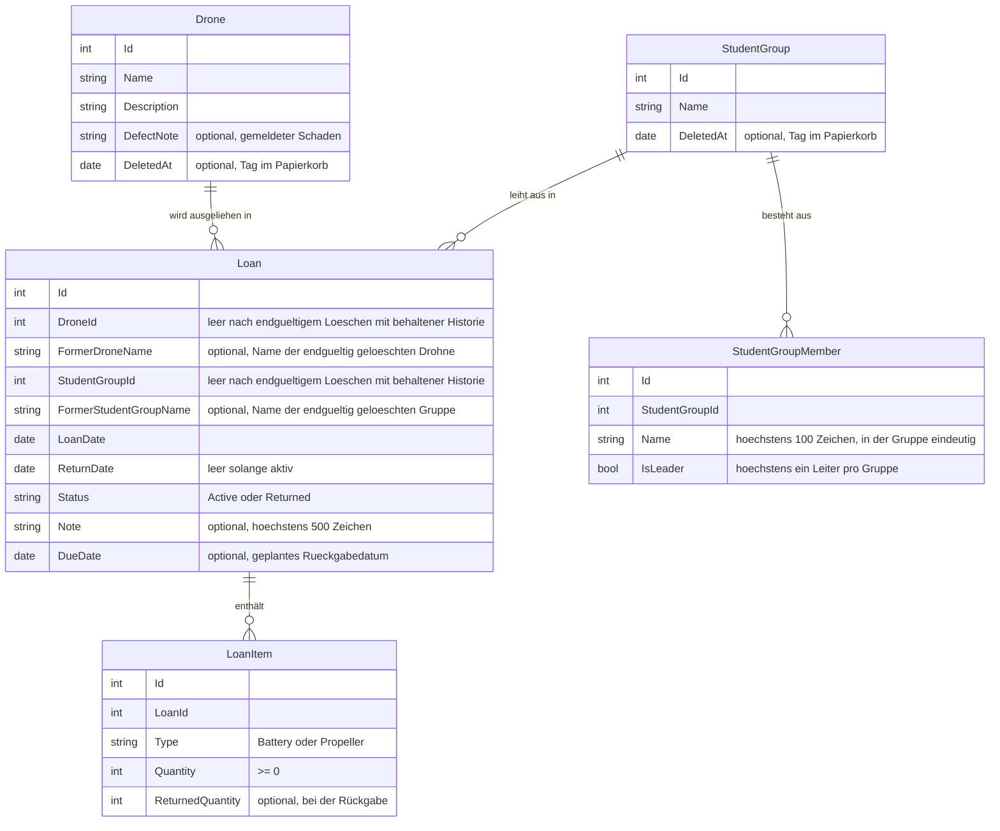

# Domänenmodell: Drohnenverwaltung

## Ubiquitous Language

Diese Begriffe gelten überall: in Anforderung, Spec, Code, Datenbank und im Gespräch. Synonyme wie "Verleih", "Ausgabe" oder "Buchung" werden nicht verwendet.

| Begriff | Bedeutung |
|---|---|
| Drone | Ein Fluggerät, das ausgeliehen werden kann |
| StudentGroup | Eine Schülergruppe, die ausleiht und verantwortlich ist |
| Member | Eine Person in einer StudentGroup, nur mit Namen |
| Trash | Papierkorb: Eine gelöschte StudentGroup oder Drone liegt dort mit ihren Ausleihen, bis sie wiederhergestellt oder endgültig gelöscht wird |
| Group leader | Das Mitglied, das für die StudentGroup verantwortlich ist; höchstens eines pro Gruppe |
| Loan | Ein Ausleihvorgang mit Gruppe, Drohne, Datum und Status |
| LoanItem | Eine Zubehörposition einer Ausleihe: Typ und Menge |
| Active / Returned | Zustand eines Loan |
| Available / Loaned / Defective | Zustand einer Drone: Defective bei gemeldetem Schaden, sonst ergibt er sich aus der aktiven Ausleihe |
| Battery / Propeller | Erlaubte Typen eines LoanItem |

## Modell

## Einordnung nach DDD

- **Drone und StudentGroup sind Entities.** Sie haben eine eigene Identität und bleiben dieselbe Drohne oder Gruppe, auch wenn sich ihre Daten ändern. Deshalb lässt sich die Geschichte einer Drohne über mehrere Ausleihen verfolgen.
- **Loan ist die zentrale Entity und Wurzel eines Aggregates.** Sie verbindet Drohne, Gruppe, Zeit und Zubehör. Änderungen an einer Ausleihe laufen immer über den Loan.
- **LoanItem gehört zum Aggregate Loan.** Es existiert nur innerhalb einer Ausleihe und hat außerhalb keine Bedeutung. Die Id im Modell dient nur der Speicherung, fachlich verhält es sich wie ein Value Object: Es zählen nur Typ und Menge.
- **Mitglieder gehören zur StudentGroup.** Sie werden nur über ihre Gruppe angelegt und entfernt und mit ihr gelöscht. Ausleihen hängen an der Gruppe, nicht an einem Mitglied.
- **Akkus und Propeller sind keine Entities.** Sie werden nur als Menge geführt. Das ändert sich erst, wenn ein Change Request einzelne Akkus verlangt.

## Domain Rules

1. Eine Drohne hat höchstens eine aktive Ausleihe.
2. Nur verfügbare Drohnen dürfen ausgeliehen werden.
3. Eine Rückgabe macht die Drohne wieder verfügbar, außer es wird dabei ein Schaden gemeldet.
4. Zubehörmengen sind nie negativ.
5. Zurückgegebene Ausleihen bleiben gespeichert. Einzige Ausnahme: Eine StudentGroup oder Drone wird aus dem Papierkorb endgültig mit ihrer Historie gelöscht.
6. Akkus und Propeller werden nur als Menge geführt.
7. Die Verfügbarkeit ergibt sich aus dem gemeldeten Schaden und der aktiven Ausleihe. Eine defekte Drohne wird erst nach der Reparatur wieder ausgeliehen.
8. Bei der Rückgabe werden die zurückgegebenen Mengen erfasst. Fehlteile bleiben in der Historie sichtbar.
9. Ein Mitgliedsname kommt in einer Gruppe nur einmal vor, ohne Unterschied zwischen Groß- und Kleinschreibung. Eine Gruppe hat höchstens einen Gruppenleiter, und er ist Mitglied dieser Gruppe.
10. Löschen verschiebt eine StudentGroup oder Drone in den Papierkorb. Mit aktiver Ausleihe kommt sie nicht in den Papierkorb und wird nicht endgültig gelöscht. Im Papierkorb wird sie nicht ausgeliehen und nicht geändert, ihr Name bleibt vergeben.

Alle Regeln erzwingt das Backend. Das Frontend darf sie zusätzlich anzeigen, aber nicht als einzige Absicherung enthalten.

## Architekturentscheidung: Status der Drohne

**Entscheidung:** Der Status einer Drohne wird nicht gespeichert, sondern aus der aktiven Ausleihe berechnet. Eine Drohne ist Loaned, wenn es einen Loan mit Status Active gibt, sonst Available.

**Grund:** Ein eigenes Datenbankfeld wäre eine zweite Wahrheit. Wenn Feld und Ausleihe auseinanderlaufen, wäre eine Drohne zum Beispiel "Available" und trotzdem ausgeliehen. Beim Berechnen kann das nicht passieren, und eine Rückgabe muss die Drohne nicht zusätzlich ändern.

**Folge:** Die Regel "höchstens eine aktive Ausleihe" hängt allein am Loan. Sie muss deshalb auch bei gleichzeitigen Anfragen halten. Wie das technisch abgesichert wird, gehört ins `design.md`.
