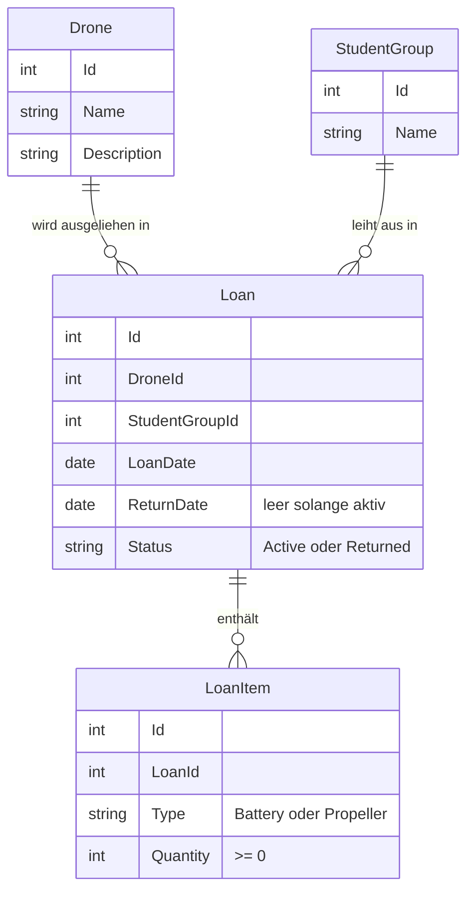

# Domänenmodell: Drohnenverwaltung

## Ubiquitous Language

Diese Begriffe gelten überall: in Anforderung, Spec, Code, Datenbank und im Gespräch. Synonyme wie "Verleih", "Ausgabe" oder "Buchung" werden nicht verwendet.

| Begriff | Bedeutung |
|---|---|
| Drone | Ein Fluggerät, das ausgeliehen werden kann |
| StudentGroup | Eine Schülergruppe, die ausleiht und verantwortlich ist |
| Loan | Ein Ausleihvorgang mit Gruppe, Drohne, Datum und Status |
| LoanItem | Eine Zubehörposition einer Ausleihe: Typ und Menge |
| Active / Returned | Zustand eines Loan |
| Available / Loaned | Zustand einer Drone, ergibt sich aus der aktiven Ausleihe |
| Battery / Propeller | Erlaubte Typen eines LoanItem |

## Modell

## Einordnung nach DDD

- **Drone und StudentGroup sind Entities.** Sie haben eine eigene Identität und bleiben dieselbe Drohne oder Gruppe, auch wenn sich ihre Daten ändern. Deshalb lässt sich die Geschichte einer Drohne über mehrere Ausleihen verfolgen.
- **Loan ist die zentrale Entity und Wurzel eines Aggregates.** Sie verbindet Drohne, Gruppe, Zeit und Zubehör. Änderungen an einer Ausleihe laufen immer über den Loan.
- **LoanItem gehört zum Aggregate Loan.** Es existiert nur innerhalb einer Ausleihe und hat außerhalb keine Bedeutung. Die Id im Modell dient nur der Speicherung, fachlich verhält es sich wie ein Value Object: Es zählen nur Typ und Menge.
- **Akkus und Propeller sind keine Entities.** Sie werden nur als Menge geführt. Das ändert sich erst, wenn ein Change Request einzelne Akkus verlangt.

## Domain Rules

1. Eine Drohne hat höchstens eine aktive Ausleihe.
2. Nur verfügbare Drohnen dürfen ausgeliehen werden.
3. Eine Rückgabe macht die Drohne wieder verfügbar.
4. Zubehörmengen sind nie negativ.
5. Zurückgegebene Ausleihen bleiben gespeichert.
6. Akkus und Propeller werden nur als Menge geführt.
7. Die Verfügbarkeit ergibt sich aus der aktiven Ausleihe.

Alle Regeln erzwingt das Backend. Das Frontend darf sie zusätzlich anzeigen, aber nicht als einzige Absicherung enthalten.

## Architekturentscheidung: Status der Drohne

**Entscheidung:** Der Status einer Drohne wird nicht gespeichert, sondern aus der aktiven Ausleihe berechnet. Eine Drohne ist Loaned, wenn es einen Loan mit Status Active gibt, sonst Available.

**Grund:** Ein eigenes Datenbankfeld wäre eine zweite Wahrheit. Wenn Feld und Ausleihe auseinanderlaufen, wäre eine Drohne zum Beispiel "Available" und trotzdem ausgeliehen. Beim Berechnen kann das nicht passieren, und eine Rückgabe muss die Drohne nicht zusätzlich ändern.

**Folge:** Die Regel "höchstens eine aktive Ausleihe" hängt allein am Loan. Sie muss deshalb auch bei gleichzeitigen Anfragen halten. Wie das technisch abgesichert wird, gehört ins `design.md`.
